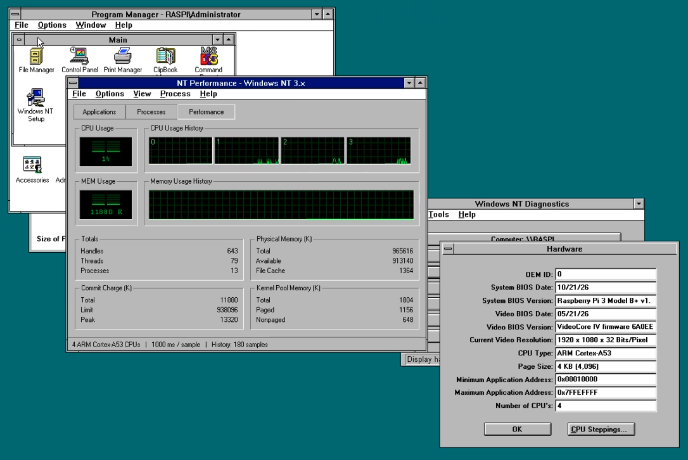

# PINT - Raspberry PI Windows NT

Windows NT 3.5 ported to 32-bit ARM (ARMv7-A) on the Raspberry Pi 2, 3 and 4, with own ARC firmware.

## Raspberry Pi models

- Tested: Pi 2 Model B v1.1 (BCM2836, Cortex-A7), Pi 2 Model B v1.2, Pi 3 Model B v1.2, v1.3 and B+ v1.3 (BCM2837,
  Cortex-A53), Pi 4 Model B v1.4 and Pi 400 (BCM2711, Cortex-A72: USB-A ports and Ethernet; NT uses the first GB of
  memory) and QEMU `raspi2b`, `raspi3b`, `raspi3ap`, `raspi4b`.
- Also tested: Zero 2 W (BCM2837). Untested, should work: 3A+ (BCM2837), CM4 (BCM2711).
- NT runs its multiprocessor kernel on all four cores of every model.
- On the boards with the wireless chip (Pi 3, Zero 2 W) the SD card runs on the BCM2837's SD host controller
  (SDHOST), where the GPU firmware boots from, which leaves the Arasan EMMC controller to the chip. The Pi 2 keeps
  its card on the EMMC. The Pi 4's card is on its EMMC2.
- Not planned:
  - Pi 1, Zero, Zero W: ARMv6 (ARM1176), no Thumb-2.
  - Pi 5, Pi 500: the Cortex-A76 runs 32-bit code only in user mode.

## Why not Pi 1 or Pi 5

Microsoft's compiler, the only 32-bit ARM compiler with NT's exception handling, makes only Thumb-2 code, not the ARMv6
code the Pi 1 and Zero need, and the Pi 5 cannot run a 32-bit kernel at all.

## Build

The NT 3.5 source (`PRIVATE`, `PUBLIC`) and DEC's ADK (`arc/adk`, for the ARC DOS shell) go beside this tree and are
not part of it; the port's versions of their files are edit scripts (`*.ntdiff`) the build applies to them
(`tools/ntdiff.pl`).

Everything builds in Docker with Microsoft C for ARM ([msvc-arm32](https://hub.docker.com/r/tenox7/msvc-arm32)),
installed once into `../msvc` beside the NT source; sources and outputs stay on the host, Docker only runs the tools:

    docker run --rm -e ACCEPT_MSVC_LICENSE=yes -v "$PWD/../msvc":/opt/msvc tenox7/msvc-arm32 msvc-setup
    build/build-all.sh      # everything from scratch -> obj/arcfw.{elf,bin}, obj/nt-arcfw-sd.img
    build/build-update.sh   # only what changed since the last build

`build-update.sh` runs only the steps whose files changed (`obj/stamp`) and copies what they made into the existing
system disk, keeping what NT wrote on it; the disk is made anew when the registry hives change. Builds run `J` steps
at once (default 8, `J=1` in order) and `CJ` compiles per step (default 4).

    build/portable-qemu-image.sh  # obj/pint-qemu.tar.gz: the system disk, firmware and QEMU for macOS, Linux, Windows

Run it on a Mac with Homebrew `qemu` and `dylibbundler`; `IMG=disk.img` packs another disk, `FORCE=1` rebuilds the
bundled QEMU.

## Run

    build/run.sh                  # console on serial in this terminal (Ctrl-A X quits)
    build/run.sh -device usb-kbd  # console on the HDMI window + USB keyboard
    M=raspi3b build/run.sh        # a Pi 3B (M=raspi3ap: a 3A+, M=raspi4b: a Pi 4B, QEMU 11.1 or later)
    IMG=disk.img build/run.sh     # another system disk
    build/run.sh -h               # the common options; the others go to QEMU

The firmware puts the console on HDMI when a USB keyboard is present, otherwise on serial. run.sh always attaches a USB
mouse (click the window to give it to NT, Ctrl+Alt+G releases it) and a DS1307-type RTC at 0x68 on I2C1 (GPIO 2/3),
where the HAL keeps the time. Without an RTC the clock starts each boot at the firmware build date.

The first run is NT's developer setup (three boots, on its own). From the third boot on, NT logs on as Administrator
by itself (password `password`). Hold Shift while it logs on to get the Logon box; Ctrl+Alt+Del (QEMU monitor:
Ctrl-A C, `sendkey ctrl-alt-delete`, Ctrl-A C) opens Windows NT Security.

The resolution is `framebuffer_width` and `framebuffer_height` of the SD card's `config.txt` (1920x1080; without them the
display's mode), in QEMU `RES=1280x1024 build/run.sh`.

For a real Pi 2, 3 or 4, write `obj/nt-arcfw-sd.img` to an SD card. USB keyboards and mice, behind hubs too (and KVMs
with an absolute mouse, such as PiKVM), can be plugged in at any time; the boot menu lists the USB devices it found.

## Networking

Networking works: TCP/IP with DHCP and NetBIOS over TCP/IP, so NT maps shares of Windows and Samba servers (File Manager
or `net use`), shares its own folders (`net share`), and has ping, ipconfig and hostname. It uses the onboard Ethernet
(LAN9514 on the Pi 2/3B, LAN7800 on the 3B+, the BCM2711's GENET on the Pi 4), in QEMU a USB Ethernet adapter
(`NONET=1 build/run.sh`: none). Control Panel > Network configures it: TCP/IP (DHCP or a static address, DNS, WINS),
bindings, computer name and workgroup. Its Add Software > TCP/IP Protocol installs the Simple TCP/IP Services.

## Wireless

The onboard Wi-Fi of the Pi 3, 3B+, 3A+, 4, 400 and Zero 2 W is a second network adapter, Raspberry Pi Wireless
Adapter (`drivers/bcmwlan`), with TCP/IP and DHCP. Set the network in `config.txt` on the card before booting:

    wifi_ssid=MyNetwork
    wifi_password=my passphrase
    wifi_security=WPA2      (WPA2, WPA2/WPA3 (joined with WPA2) or OPEN)
    wifi_country=US         (the regulatory domain; XX by default)
    debug_wifi=1            (log to C:\WLAN.LOG)

With no `wifi_ssid` the adapter is not started. A network that cannot be joined (wrong name or passphrase) is
noted in `C:\WLAN.LOG` even without `debug_wifi`. On a board with no Ethernet (3A+, Zero 2 W) and no `wifi_ssid`, the network
services have no adapter, and NT says at each start that a service or driver failed, until a network is set.

The chip's firmware files are Raspberry Pi OS's, licensed for Raspberry Pi hardware only: the image build fetches
them, and the repository does not hold them (the QEMU package's disk is made without them). On the Pi 3 and
Zero 2 W the SD card runs on the SD host controller (SDHOST), which leaves the EMMC controller to the wireless
chip; the Pi 2 keeps it on the EMMC.

## Sound

The sound driver (`drivers/bcmsound`, with `bcmsnd32.dll`) is a sound card as NT's Windows Sound System driver is: a
wave output, a mixer (Volume Control) and an FM synthesizer for MIDI. It plays through HDMI or the 3.5 mm jack; in
QEMU it is silent. In `config.txt`:

    sound_output=AUTO       (AUTO (HDMI if the display takes sound, else the jack), HDMI, JACK or NONE)
    debug_sound=1           (log to C:\SOUND.LOG)

MIDI files play through the MIDI Mapper, whose setup `Raspberry Pi` the image's `MIDIMAP.CFG` holds (`tools/midimap.pl`
makes it from NT's file when the image is built). NT's sounds and `CANYON.MID` are in `\WINNT`.

## RDP server

ntrdps (https://github.com/tenox7/ntrdps), an RDP server, lets an RDP client use NT's desktop, as VNC does. It is off
by default: its installer, `C:\NTRDPS\NTRDPSET.EXE`, is on the disk, and nothing is installed until you run it. To turn
it on, run the installer, click Install (it adds its service and its layered display driver), give the user name and
password RDP clients must use (NT 3.5 cannot check a Windows password for it, so ntrdps keeps its own) and let it
restart NT. Remove, in the same installer, turns it off again. Use it only on a network you trust. It comes from its
own release (Apps and games, below).

## FTP server

NT 3.5's FTP Server is installed with its Control Panel applet (FTP Server) and does not start by itself:
`net start ftpsvc`. The accounts of the machine log on (`Administrator`), to every drive, read and write, starting
in `C:\InetPub\ftproot`; anonymous access is off, and the applet turns it on with an account you name. In
FileZilla, set the site's server type to a DOS/Windows one: the server reports drive paths (`C:/`).

## Crash dumps

Off by default. With both settings in `config.txt`, NT writes its memory at a STOP screen and saves it as
`C:\WINNT\MEMORY.DMP` at the next start; C: needs about twice the limit free. `tools/dumpinfo.pl MEMORY.DMP` prints the
STOP code, the registers and the loaded drivers. `myfault now` stops NT with a STOP screen on demand, to try it.

    crash_dump=1
    total_mem=256           (the Pi firmware's memory limit, in MB: required)

## Task Manager

Ctrl+Esc, or a double-click on the desktop, opens an NT 4-style task manager (`\APPS\TASKMAN\TASKMAN.EXE`, from
https://github.com/tenox7/nt31taskman) in place of Program Manager's Task List: Applications (Switch To, End Task),
Processes (End Process, Set Priority, more columns under View) and Performance (CPU and memory history, a graph per
CPU). The default hive names it in `Winlogon\Taskman`; unchecking its Options > Replace Task List brings the Task List
back at the next logon. It comes from its own release (Apps and games, below).

## Time zones

The registry's time zones are the 142 of Windows today (Unicode CLDR `windowsZones.xml`), each one's rule
computed from the IANA tz database (2026f) by `tools/xptimezones.pl`, which also makes a `.reg` to update
a system already installed. The system's own zone keys are kept and take today's rules; the zones it lacked
are added (among them Canada's of 2026: British Columbia, Alberta with the Northwest Territories, Manitoba;
and Yukon). After importing such a `.reg`, choose the time zone again in Date and Time: the system keeps
its own copy of the current zone's rule until then.

The system keeps one rule a zone for every year: "the n-th (or last) weekday of a month, at a local time"
(the per-year rules of Windows, "dynamic DST", came with Vista). Three zones change their clocks relative
to another day, which no such rule matches every year; in the years listed the change comes a week off:

| Zone | Real rule | Rule kept | Years a week off (2028-2047) |
| --- | --- | --- | --- |
| Greenland Standard Time (Nuuk) | 01:00 UTC on the last Sunday of March and October (23:00 local the Saturday before) | last Saturday, 23:00 | start of DST in 2029, 2035, 2040, 2046 (late) |
| Israel Standard Time | the Friday before the last Sunday of March, 02:00 | 4th Friday of March | start of DST in 2030, 2041, 2047 (early) |
| West Bank Standard Time | the Saturday before the last Sunday of March and of October | last Saturday | start in 2029, 2035, 2040, 2046; end in 2036-2039, 2043 |

Every other zone is right for every year. To regenerate the list when tz changes: get the release
(`tzdata*.tar.gz` from data.iana.org), compile it with `zic -d DIR`, take CLDR's `windowsZones.xml`, and
run the tool as its header says.

## SDK tools

The tools of the NT source's `PRIVATE\SDKTOOLS` that build for ARM are in `\SDKTOOLS` (`build/build-sdktools.sh`), not on
the PATH.

## SDK

The PINT 3.5 SDK builds programs, DLLs and drivers for PINT outside this tree with Microsoft C for ARM (MSVC 14.44 of
Visual Studio 2022; Visual Studio 2026 has no ARM32 compiler). It has the NT 3.5 headers, PINT's libraries, the Win32
SDK's ntwin32.mak with ARM, a driver kit, and its own cl and link, which mark each image for NT 3.5 (the ARM linker
marks it 6.02, which NT 3.5 does not start). No MFC. `build/make-sdk.sh` makes `obj/pint35sdk.zip` for Windows
(`setenv.cmd`, then nmake or cl) and, in `obj/sdk/docker`, the Docker image tenox7/pint35sdk on tenox7/msvc-arm32
(`docker build -t tenox7/pint35sdk obj/sdk/docker`). `sdk/README.txt` has the details.

## Apps and games

The apps and games come from their own repositories on GitHub, which build them with the SDK and put them in their
releases. Each has a recipe here, `extras/NAME.sh`. The build (`build/build-extras.sh`, in `build/build-update.sh`)
downloads what a recipe names from the newest release that has it, and checks each file against the SHA-256 that GitHub
has of it. When GitHub does not answer, the build keeps what it has. GitHub answers 60 requests an hour; set
`GITHUB_TOKEN` to build more often.

- `\APPS`, in Program Manager's Main group, each in its own folder: TenoxVNC (https://github.com/tenox7/tenoxvnc, a
  VNC viewer), ntfetch (https://github.com/tenox7/ntfetch), ntrdpc (https://github.com/tenox7/ntrdpc, an RDP client),
  PuTTY (https://github.com/tenox7/puttyNT, with Plink, PSCP, PSFTP, Pageant and PuTTYgen) and the task manager
  (above). Internet Explorer 1.5 is there too; it is built here (`apps/ie`).
- `\GAMES`, in the Games group, each in its own folder: the 11 games of https://github.com/tenox7/ntgames, WiNTown
  (https://github.com/tenox7/wintown), Sabre (https://github.com/tenox7/sabreNT) and OpenTTD
  (https://github.com/tenox7/openttdNT, in a window: NT 3.5 changes no display modes). Prince of Persia
  (https://github.com/tenox7/popNT) runs on PINT 4.0 only (its SDL needs NT 4.0).
- `\NTRDPS`: the installer of ntrdps (https://github.com/tenox7/ntrdps), the RDP server (above).

An item of a group starts in the folder of its program. A recipe without `REPO` builds its extra in the environment of
the NT build instead, from its checkout in `extras/` (or a link to it).

## Adding a program

Programs from other GitHub repositories can go on the image too: name the repositories in `APPS` when the image is
made.

    APPS="OWNER/NAME OWNER/NAME2" sdcard/make-sd-image.sh

Of each repository, the build downloads the newest release (not a draft or a pre-release) that has one file with
`pint35` in its name, and checks it against the SHA-256 that GitHub has of it:

- a program (`.exe`) goes to `\APPS\NAME\NAME.EXE`
- a `.zip` is unpacked into `\APPS\NAME`, without the one folder it may hold

Each program of Windows (not of the console) gets an item in Program Manager's Main group, which starts in its
folder. The item has the name of the repository, or of the program when it comes from a .zip. The first run of a new
disk makes the items; `build/build-update.sh`, which updates the disk in place, takes `APPS` too but copies only the
files. When GitHub does not answer, the build keeps what it downloaded before. A repository that PINT downloads
already (such as tenox7/wintown) is left out, and so is a name that PINT has in `\APPS` (such as ntfetch).

To make a program for this, build it with the SDK (above) and put it in a GitHub release with `pint35` in the file
name, such as `myapp-pint35.exe` (and `myapp-pint40.exe` for PINT 4.0, in the same release). The next image takes a
new release by itself. Add only programs whose license allows giving them away with the image.

## Adding a program to PINT

A program can also come with every image of PINT 3.5. Its GitHub repository builds it with the SDK and puts it in its
releases, as above. Then a pull request to branch `782` adds it here, in three files. After that, each image takes the
newest release by itself.

`extras/myapp.sh`, its recipe (`build/build-extras.sh` has all that a recipe can set):

    # MyApp, what it is, https://github.com/OWNER/myapp: its build for PINT 3.5, from the newest release that has
    # it, into \APPS\MYAPP, with its LICENSE. In the Main group (sdcard/make-sd-image.sh).
    REPO=OWNER/myapp
    GET="myapp.exe=myapp-arm-pint35.exe LICENSE=/LICENSE"
    BUILD='perl -pi -e "s/\r*\$/\r/" LICENSE'
    DEST=APPS/MYAPP
    FILES="myapp.exe LICENSE"

`GET` names what the recipe takes of the release: `NAME=PATTERN`, a file of the release, as NAME; `PATTERN`, a
`.zip` of the release, unpacked; `NAME=/PATH`, the file PATH of the repository at that release. `BUILD` is optional;
it runs where the files are, here to give the license the line ends of Windows. A game goes to `GAMES/NAME`.

`sdcard/make-sd-image.sh`, its item in the Main group: a line after the other `grp MAIN` lines. `MyApp` is the name of
the item, `myapp` that of the program (`myapp.exe`). A game takes `grp GAMES GAMES/MYAPP 5 ...`, in the Games group.

    grp MAIN APPS/MYAPP 6 MyApp=myapp

Last, `README.md`: a line in Apps and games (above). For PINT 4.0, send another pull request, to branch `1381`; its
README has its steps.

## Roadmap

- Pi 4: memory above the first GB, the USB-C port, USB Ethernet adapters.

## Legal

- This repository contains no Microsoft or Windows copyrighted material. 
- It is just a build toolchain plus own ARM ARC firmware code. 
- Written from scratch by Dave Clanker based on U-Boot.
- Public domain.
