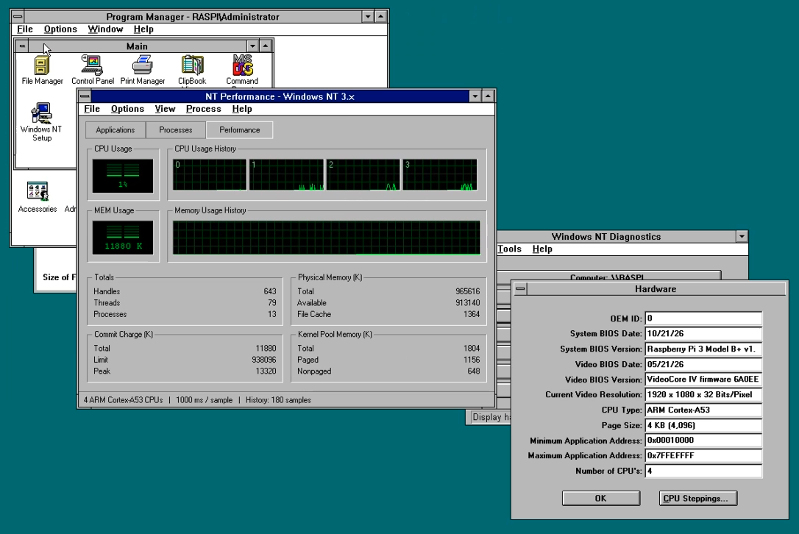

# PINT - Raspberry PI Windows NT

Windows NT 3.5 ported to 32-bit ARM (ARMv7-A) on the Raspberry Pi 2, 3 and 4, with own ARC firmware.

## Raspberry Pi models

- Tested: Pi 2 Model B v1.1 (BCM2836, Cortex-A7), Pi 2 Model B v1.2, Pi 3 Model B v1.2, v1.3 and B+ v1.3 (BCM2837,
  Cortex-A53), Pi 4 Model B v1.4 and Pi 400 (BCM2711, Cortex-A72: USB-A ports and Ethernet; NT uses the first GB of
  memory) and QEMU `raspi2b`, `raspi3b`, `raspi3ap`, `raspi4b`.
- Untested, should work: 3A+, Zero 2 W (BCM2837), CM4 (BCM2711).
- NT runs its multiprocessor kernel on all four cores of every model.
- On the Pi 2, 3 and Zero 2 W the SD card runs on the BCM2836/7's SD host controller (SDHOST), where the GPU
  firmware boots from, which leaves the Arasan EMMC controller to the on-board wireless chip of the Pi 3 and
  Zero 2 W. The Pi 4's card is on its EMMC2.
- Not planned:
  - Pi 1, Zero, Zero W: ARMv6 (ARM1176), no Thumb-2.
  - Pi 5, Pi 500: the Cortex-A76 runs 32-bit code only in user mode.

## Why not Pi 1 or Pi 5

Microsoft's compiler, the only 32-bit ARM compiler with NT's exception handling, makes only Thumb-2 code, not the ARMv6
code the Pi 1 and Zero need, and the Pi 5 cannot run a 32-bit kernel at all.

## Build

The NT 3.5 source (`PRIVATE`, `PUBLIC`) and DEC's ADK (`arc/adk`, for the ARC DOS shell) go beside this tree and are
not part of it; the port's versions of their files are edit scripts (`*.ntdiff`) the build applies to them
(`tools/ntdiff.pl`).

Everything builds in Docker with Microsoft C for ARM ([msvc-arm32](https://hub.docker.com/r/tenox7/msvc-arm32)),
installed once into `../msvc` beside the NT source; sources and outputs stay on the host, Docker only runs the tools:

    docker run --rm -e ACCEPT_MSVC_LICENSE=yes -v "$PWD/../msvc":/opt/msvc tenox7/msvc-arm32 msvc-setup
    build/build-all.sh      # everything from scratch -> obj/arcfw.{elf,bin}, obj/nt-arcfw-sd.img
    build/build-update.sh   # only what changed since the last build

`build-update.sh` runs only the steps whose files changed (`obj/stamp`) and copies what they made into the existing
system disk, keeping what NT wrote on it; the disk is made anew when the registry hives change. Builds run `J` steps
at once (default 8, `J=1` in order) and `CJ` compiles per step (default 4).

    build/portable-qemu-image.sh  # obj/pint-qemu.tar.gz: the system disk, firmware and QEMU for macOS, Linux, Windows

Run it on a Mac with Homebrew `qemu` and `dylibbundler`; `IMG=disk.img` packs another disk, `FORCE=1` rebuilds the
bundled QEMU.

## Run

    build/run.sh                  # console on serial in this terminal (Ctrl-A X quits)
    build/run.sh -device usb-kbd  # console on the HDMI window + USB keyboard
    M=raspi3b build/run.sh        # a Pi 3B (M=raspi3ap: a 3A+, M=raspi4b: a Pi 4B, QEMU 11.1 or later)
    build/run.sh -h               # the common options; the others go to QEMU

The firmware puts the console on HDMI when a USB keyboard is present, otherwise on serial. run.sh always attaches a USB
mouse (click the window to give it to NT, Ctrl+Alt+G releases it) and a DS1307-type RTC at 0x68 on I2C1 (GPIO 2/3),
where the HAL keeps the time. Without an RTC the clock starts each boot at the firmware build date.

The first run is NT's developer setup (three boots, on its own). From the third boot on, NT logs on as Administrator
by itself (password `password`). Hold Shift while it logs on to get the Logon box; Ctrl+Alt+Del (QEMU monitor:
Ctrl-A C, `sendkey ctrl-alt-delete`, Ctrl-A C) opens Windows NT Security.

The resolution is `framebuffer_width` and `framebuffer_height` of the SD card's `config.txt` (1920x1080; without them the
display's mode), in QEMU `RES=1280x1024 build/run.sh`.

For a real Pi 2, 3 or 4, write `obj/nt-arcfw-sd.img` to an SD card. USB keyboards and mice, behind hubs too (and KVMs
with an absolute mouse, such as PiKVM), can be plugged in at any time; the boot menu lists the USB devices it found.

## Networking

Networking works: TCP/IP with DHCP and NetBIOS over TCP/IP, so NT maps shares of Windows and Samba servers (File Manager
or `net use`), shares its own folders (`net share`), and has ping, ipconfig and hostname. It uses the onboard Ethernet
(LAN9514 on the Pi 2/3B, LAN7800 on the 3B+, the BCM2711's GENET on the Pi 4), in QEMU a USB Ethernet adapter
(`NONET=1 build/run.sh`: none). Control Panel > Network configures it: TCP/IP (DHCP or a static address, DNS, WINS),
bindings, computer name and workgroup. Its Add Software > TCP/IP Protocol installs the Simple TCP/IP Services.

## FTP Server

NT 3.5's FTP Server (`ftpsvc.dll` in `tcpsvcs.exe`) is installed but not started: start it in Control Panel > Services
(FTP Server) or with `net start ftpsvc`. It takes the accounts of the machine and anonymous users (`anonymous` or `ftp`,
any password), who are logged on as the account `FTP_RASPI`, a guest the first boot makes; the home directory is `C:\`
and every drive can be read and written, to bring files to the machine. Control Panel > FTP Server shows the connected
users; Network > FTP Server > Configure changes the settings (`Services\FTPSVC\Parameters` in the registry).

## Wireless

The on-board Wi-Fi of the Pi 3, 3B+, 3A+, 4, 400 and Zero 2 W (a Broadcom BCM43430 or Cypress CYW43436 or CYW43455 on
SDIO) is a second network adapter, Raspberry Pi Wireless Adapter (`drivers/bcmwlan`, an NDIS 3.0 miniport), bound to
TCP/IP with DHCP. The chip's own firmware joins the network and runs the WPA2 and WPA3 supplicant. Before booting, set
the network in `config.txt` on the card's FAT partition, on any computer (the boot firmware passes over these keys, and
Windows NT reads them as `C:\CONFIG.TXT`):

    wifi_ssid=MyNetwork
    wifi_password=my passphrase
    wifi_security=WPA2      (WPA2, WPA3, WPA2/WPA3 or OPEN)
    wifi_country=US         (the regulatory domain; XX by default)

The registry values `Ssid`, `Passphrase`, `Security` and `Country` of
`HKLM\System\CurrentControlSet\Services\Bcmwlan1\Parameters` take precedence when set. With `debug_wifi=1` the driver
logs each step to `C:\WLAN.LOG`. The chip's firmware, NVRAM and regulatory files are Raspberry Pi OS's
(RPi-Distro/firmware-nonfree), licensed for Raspberry Pi hardware only: the image build fetches them into
`\WINNT\System32\Drivers\BCMWLAN`, and the repository does not hold them. QEMU has no wireless chip; the firmware
describes the adapter only when the chip answers.

## Sound

The sound driver (`drivers/bcmsound`) is a sound card driver as NT 3.5's Windows Sound System driver is: a kernel driver
on NT's sound library (`bcmsound.sys`) with a wave output, a mixer and an FM synthesizer, and its multimedia driver
(`bcmsnd32.dll`, on NT's drvlib and synthlib, as `sndsys32.dll` is), which makes them the system's wave, mixer and MIDI
devices. The wave output plays PCM at 8 to 48 kHz, 8 or 16 bits, mono or stereo; the driver mixes it with the
synthesizer, an emulated OPL3, at 48 kHz, at the volumes of the mixer. MIDI files play through the MIDI Mapper, whose
setup `Raspberry Pi` (all 16 channels on the synthesizer) the image's `MIDIMAP.CFG` holds: `tools/midimap.pl` makes it
from NT's file when the image is built. `CANYON.MID` and NT's sounds are in `\WINNT`.

It drives the hardware directly through a DMA channel the firmware leaves to the ARM: HDMI audio on the display the
firmware brought up (Pi 2, 3, Zero 2 W; HDMI0 or HDMI1 of a Pi 4 or 400), or the 3.5 mm jack (the PWM: Pi 2, 3B, 3B+,
3A+, 4B). Before booting, choose in `config.txt` on the card's FAT partition:

    sound_output=AUTO       (AUTO, HDMI, JACK or NONE)

AUTO plays through HDMI when the display's EDID says it takes sound, else through the jack. The registry value `Output`
of `HKLM\System\CurrentControlSet\Services\Bcmsound\Parameters` takes precedence when set. With `debug_sound=1` the
driver logs what it found to `C:\SOUND.LOG`. QEMU has neither output: there the devices are silent but keep the time of
the sounds.

## Crash dumps

For debugging, NT can write a crash dump, all of its memory, when it stops with a STOP screen. It is off by default. In
`config.txt` on the card's FAT partition, both:

    crash_dump=1            (the ARC firmware passes NT the CRASHDUMP option)
    total_mem=256           (the Pi firmware's memory limit, in MB: required)

`crash_dump` counts only with a `total_mem` limit, so that a dump fits: the SD card driver (`drivers/bcmemmc`) turns
NT's crash dumps on and sizes the pagefile on C: to that limit; after a crash its own copy writes the dump into the
pagefile (through `diskdump.sys`, polled), and at the next start winlogon runs savedump, which copies it to
`C:\WINNT\MEMORY.DMP`. C: needs about twice the limit free (grow the partition). Copy `MEMORY.DMP` off the card and read
it with `tools/dumpinfo.py MEMORY.DMP`: the STOP code, the registers, the loaded drivers and which driver each address
is in. Without the setting the driver turns dumps off and puts the previous pagefile setting back.

## Task Manager

Ctrl+Esc, or a double-click on the desktop, opens an NT 4-style task manager (`apps/taskman`, TASKMAN.EXE) in place of
Program Manager's Task List: Applications (Switch To, End Task), Processes (End Process, Set Priority, more columns
under View) and Performance (CPU and memory history, a graph per CPU). The default hive names it in
`Winlogon\Taskman`; unchecking its Options > Replace Task List brings the Task List back at the next logon.

## Games

Program Manager's Games group has, beside Solitaire, Minesweeper and FreeCell, the games of `apps/games`, in `\GAMES`:
2048, Breakout, Bubble Breaker, Moon Lander, Missile Command, Snake (NTSNAKE.EXE: SNAKE.EXE is the Entertainment
Pack's), Tankz, NT Rigue, RISCque, Sokoban, RISCoban and WiNTown, a port of Micropolis. They were written for NT 4 and
changed to the API of NT 3.5 in October 2026. WiNTown and the Micropolis simulator are under the GPL 3.0 with Electronic
Arts' additional terms (`apps/games/wintown/LICENSE`); the other games are public domain.

## VNC viewer

`\APPS\TENOXVNC.EXE` (TenoxVNC in the Main group) is the Win32 build of TenoxVNC (`apps/tenoxvnc`, from
github.com/tenox7/tenoxvnc), a VNC viewer. Run without a server, it asks for one (`host`, `host:display` or
`host::port`), with the password, encoding and colors; F8 opens its menu (full screen, Ctrl+Alt+Del, clipboard,
settings). It is under the GPL 2.0 (`apps/tenoxvnc/LICENCE.TXT`), its zlib and IJG JPEG decoders under their own terms
(`LICENSE.zlib`, `README.jpeg`).

## ntfetch

`\APPS\NTFETCH.EXE` (ntfetch in the Main group) is ntfetch (`apps/ntfetch`, from github.com/tenox7/ntfetch): the
system at a glance, in one window in the style of WinMSD; `ntfetch --text > FILE` writes it as text.

## SDK tools

The tools of the NT source's `PRIVATE\SDKTOOLS` that build for ARM are in `\SDKTOOLS` (`build/build-sdktools.sh`), not on
the PATH.

## Roadmap

- Pi 4: memory above the first GB, the USB-C port, USB Ethernet adapters.

## Legal

- This repository contains no Microsoft or Windows copyrighted material. 
- It is just a build toolchain plus own ARM ARC firmware code. 
- Written from scratch by Dave Clanker based on U-Boot.
- Public domain.
